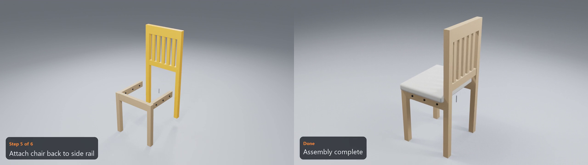
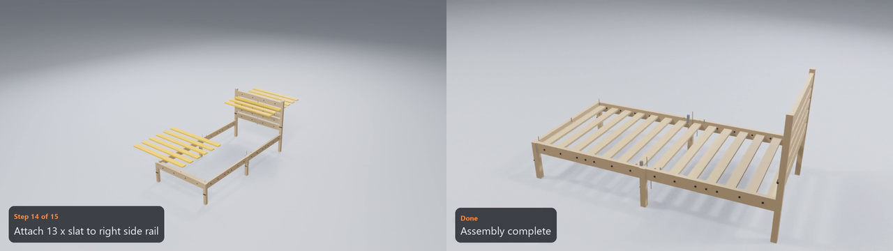
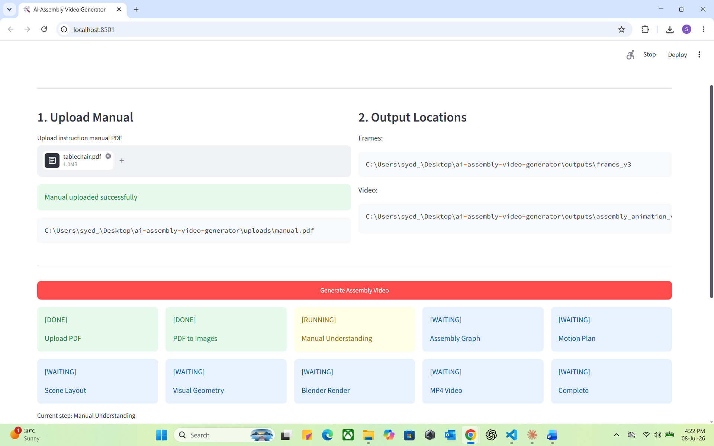
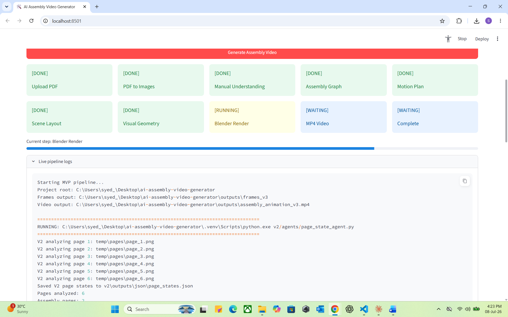
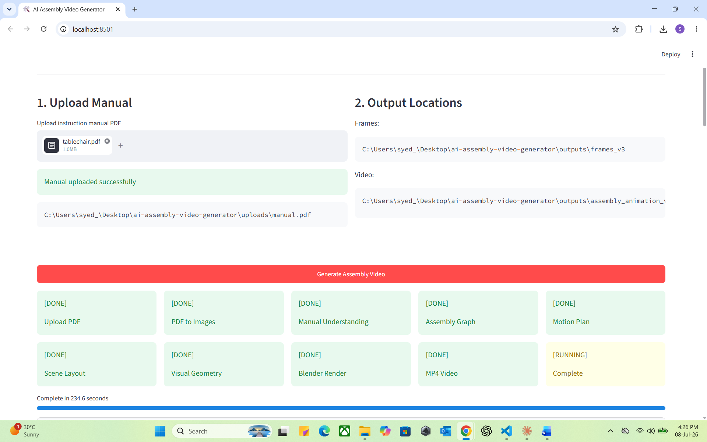

# AI Assembly Video Generator

**Turn a flat-pack assembly manual (PDF) into an animated, step-by-step assembly video.**

GPT-4o vision reads the manual's pages. A chain of Python stages turns what it sees into an assembly graph, a motion plan and a 3D scene. Blender renders the scene headlessly, and the frames are stitched into an MP4 with on-screen step captions.

[▶ Watch the walkthrough on Loom](https://www.loom.com/share/12703483af3d4d3187db376c63d08b1b)

---

## Results

Three real manuals, three generated videos. Each image shows one step in progress and the finished piece.

**IKEA MELLTORP table.** Built upside down on its top, then turned over at the end, the way the manual shows it.


**Habitat Banbury dining chair.** The front leg frame, side rails, slatted back and seat pad, in the manual's order.



**Habitat Kaycie single bed.** Headboard, footboard, side rails joined at the centre legs, then 14 slats.



The parts are proxy shapes (boxes, cylinders and simple frames) sized from the measurements printed in each manual, not CAD models.

---

## Why I built this

When I moved to the UK, a lot of what I bought needed self-assembly, and it came with a manual of diagrams and very little text. Reading the diagrams often took longer than the assembly itself, and one misread step meant undoing work and starting again. Sometimes there was a YouTube video for the product, but often there wasn't.

So I wanted to see whether AI could read a manual and produce the video itself. This project is that experiment.

---

## How it works

The pipeline is a chain of standalone Python scripts that pass JSON files to each other. Every intermediate result is on disk, so you can inspect or rerun any single stage.

```
PDF ──► page images ──► GPT-4o vision: parts, fasteners, tools and actions per page
                                    │
        ┌───────────────────────────┘
        ▼
  state differences ──► assembly actions ──► assembly graph (pass 1)
        ──► object identity tracking ──► canonical action resolution
        ──► "Repeat xN" replication ──► assembly graph (pass 2)
        ──► motion plan ──► part shapes (sizes from the manual's measurements)
        ──► scene layout (table / chair / bed / generic)
        ──► generated Blender script ──► headless render ──► MP4 with captions
```

What each stage does:

| Stage | What it does |
|---|---|
| Page state agent (LLM) | For each page: visible parts with labels and sizes, fasteners, tools, and the actions the diagram shows |
| Diagram analyzer (LLM) | Finds the diagrams on each page and reads part-list measurements such as `(925 x 42mm)` |
| Object identity tracker | Works out that "rail 6" on page 7 is the same part kind as on page 4, and gives every physical copy its own ID |
| Action replicator | Expands a step drawn once with "Repeat x2" to every copy, but never past the number of copies the page shows |
| Assembly graph | Parts, fasteners and the connections between them, in assembly order |
| Motion planner | One motion per part. Steps that do the same thing to the same kind of part play together |
| Part shapes | Gives each part a role (top, leg, rail, post, slat, seat, chair back, leg frame) and sets its size from the measurements |
| Scene layout | Places parts by role in the finished piece and works out where each one starts. Fasteners sit where the two parts they join meet |
| Blender builder | Generates a Blender Python script: proxy meshes, highlights on moving parts, camera framing, a turn-over finale for tables, then an orbit |
| Video | Stitches the frames into an MP4 with "Step n of N" captions |

---

## Running it

Requirements: Python 3.11, [Blender 5.x](https://www.blender.org/download/), and an Azure OpenAI GPT-4o deployment for the vision stages.

```bash
python -m venv .venv
.venv\Scripts\activate
pip install -r requirements.txt
```

### Full run with Azure vision

Create a `.env` file in the repo root:

```
AZURE_OPENAI_ENDPOINT=https://<your-resource>.openai.azure.com/
AZURE_OPENAI_DEPLOYMENT=gpt-4o
BLENDER_EXE=C:\Program Files\Blender Foundation\Blender 5.1\blender.exe
```

Authentication goes through `DefaultAzureCredential`, so sign in with `az login` first. There is no API key.

```bash
streamlit run app.py                 # upload a PDF in the browser
# or
python utils/pdf_to_images.py        # uploads/manual.pdf -> temp/pages/
python v2/run_mvp_pipeline.py
```

### Offline run (no Azure)

The repo includes hand-authored vision results for three manuals. `--vision-fixture` loads them instead of calling GPT-4o, and every later stage runs exactly as normal:

```bash
python v2/run_mvp_pipeline.py --vision-fixture                                         # MELLTORP table
python v2/run_mvp_pipeline.py --vision-fixture v2/tests/fixtures/vision_banbury_chair  # Banbury chair
python v2/run_mvp_pipeline.py --vision-fixture v2/tests/fixtures/vision_kaycie_bed     # Kaycie bed
```

The video is written to `outputs/assembly_animation_v3.mp4`. Run all commands from the repo root.

### Tests

```bash
pytest v2/tests          # checks the generated JSON, so run the pipeline first
```

---

## Project structure

```text
app.py                     Streamlit UI: upload, live progress, video and JSON downloads
config.py                  Shared paths
services/foundry.py        Azure OpenAI client
utils/pdf_to_images.py     PDF -> page PNGs
v2/
  run_mvp_pipeline.py      Runs every stage in order (--vision-fixture for offline runs)
  agents/                  Vision agents, identity tracking, part shapes
  rendering/               Action extraction, graph, motion, layout, Blender builder, video
  builders/                Proxy geometry
  tests/                   Output tests and offline vision fixtures
github_demo_assets/        README images
```

Generated files go to `temp/`, `outputs/`, `blender/generated/`, `v2/outputs/json/` and `v2/output/`. All of them are git-ignored.

---

## Streamlit app

| Upload | Live pipeline | Result |
|---|---|---|
|  |  |  |

Every intermediate JSON file can be downloaded from the app, so you can see exactly what each stage decided.

---

## Current limitations

This is an experimental prototype, published with its rough edges:

- **Proxy geometry.** Parts are boxes, cylinders and simple composite frames, not real product models.
- **Layouts are written per product type.** Tables, chairs and beds are placed properly. Anything else falls back to a generic exploded ring.
- **Fasteners are approximate.** Bolts are always drawn upright. They are enlarged while moving so you can see them, then shrink to real size once fitted.
- **A few parts never move.** A part that no step moves, such as the bed's centre legs, is in place from the first frame.
- **The offline fixtures were written by hand.** They are what a vision model should return for those manuals. Live GPT-4o output will vary.
- **The app has no offline mode.** The Streamlit UI always calls Azure. Offline runs only work from the command line.
- **Windows-first.** The default Blender path is a Windows path.

---

## Roadmap

- Layout rules learned from the assembly graph instead of written per product type
- Fasteners that turn to the direction of their hole and go into it
- An offline switch in the Streamlit app
- Narration with Azure Speech
- A hosted version (Azure Container Apps, Blob storage, REST API)

---

## Author

**Syed Ali Haider.** Part of my applied AI engineering portfolio, exploring how vision models, structured reasoning and procedural graphics can make instruction manuals easier to follow.

Suggestions and pull requests are welcome.

## License

MIT
