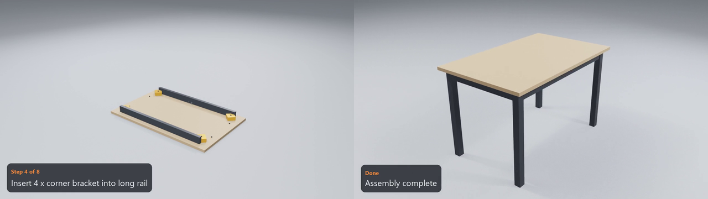
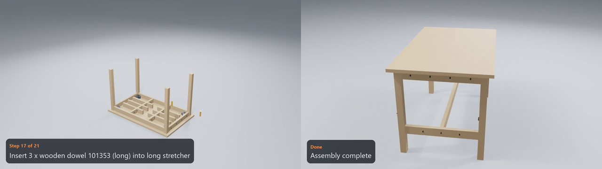

# AI Assembly Video Generator

**Turn a flat-pack assembly manual into an animated, step-by-step assembly video.**

Add a manual's PDF and describe its pages: the parts, fasteners and actions each step shows, plus any part sizes printed in it. A chain of Python stages turns that description into an assembly graph, a motion plan and a 3D scene. Blender renders the scene headlessly, and the frames are stitched into an MP4 with on-screen step captions. Everything runs locally and free, with no cloud services or paid models.

---

## Results

Four real manuals, four generated videos. Each image shows one step in progress and the finished piece.

**IKEA MELLTORP table.** Built upside down on its top, then turned over at the end, the way the manual shows it.



**IKEA NORDEN extendable table.** Frame with cross rails and runners, four legs, and an H-shaped stretcher frame between them.



**Habitat Banbury dining chair.** The front leg frame, side rails, slatted back and seat pad, in the manual's order.


**Habitat Kaycie single bed.** Headboard, footboard, side rails joined at the centre legs, then 14 slats.


The parts are proxy shapes (boxes, cylinders and simple frames) sized from the measurements printed in each manual, not CAD models.

---

## Why I built this

When I moved to the UK, a lot of what I bought needed self-assembly, and it came with a manual of diagrams and very little text. Reading the diagrams often took longer than the assembly itself, and one misread step meant undoing work and starting again. Sometimes there was a YouTube video for the product, but often there wasn't.

So I wanted to see whether a program could turn a manual's diagrams into a video automatically. This project is that experiment.

---

## How it works

```
manual.pdf ──► page images ──► page descriptions (manuals/<name>/describe.py)
        │
        ▼
  state differences ──► assembly actions ──► assembly graph (pass 1)
        ──► object identity tracking ──► canonical action resolution
        ──► "Repeat xN" replication ──► assembly graph (pass 2)
        ──► motion plan ──► part shapes (sizes from the manual's measurements)
        ──► scene layout (table / chair / bed / generic)
        ──► generated Blender script ──► headless render ──► MP4 with captions
```

**Page descriptions.** Each manual has a `describe.py` that lists, page by page, the parts with their labels and quantities, the fasteners and tools, the actions the diagrams show (with "Repeat x2" notes), and the part-list measurements such as `(925 x 42mm)`. No paid vision model reads the pages. I write the descriptions with [Claude Code](https://claude.com/claude-code), using the repo's `/describe-manual` skill: it reads the page images and writes the file. The descriptions are checked against a fixed schema before the pipeline uses them.

After that, every stage is a standalone Python script that passes JSON files to the next. Every intermediate result is on disk, so you can inspect or rerun any single stage.

| Stage | What it does |
|---|---|
| Object identity tracker | Works out that "rail 6" on page 7 is the same part kind as on page 4, and gives every physical copy its own ID |
| Action replicator | Expands a step drawn once with "Repeat x2" to every copy, but never past the number of copies the page shows |
| Assembly graph | Parts, fasteners and the connections between them, in assembly order |
| Motion planner | One motion per part. Steps that do the same thing to the same kind of part play together |
| Part shapes | Gives each part a role (top, leg, rail, stretcher, post, slat, seat, chair back, leg frame) and sets its size from the measurements |
| Scene layout | Places parts by role in the finished piece and works out where each one starts. Fasteners sit where the two parts they join meet |
| Blender builder | Generates a Blender Python script: proxy meshes, highlights on moving parts, camera framing, a turn-over finale for tables, then an orbit |
| Video | Stitches the frames into an MP4 with "Step n of N" captions |

---

## Running it

Requirements: Python 3.11 and [Blender 5.x](https://www.blender.org/download/).

```bash
python -m venv .venv
.venv\Scripts\activate
pip install -r requirements.txt
```

If Blender isn't at `C:\Program Files\Blender Foundation\Blender 5.1\blender.exe`, put its path in a `.env` file in the repo root:

```
BLENDER_EXE=C:\path\to\blender.exe
```

### Make a video for a new manual

1. Add the manual: `python utils/pdf_to_images.py path/to/manual.pdf`. Or use **Add a manual** in the app. This creates `manuals/<name>/` with the PDF and its page images.
2. Describe it: in Claude Code, run `/describe-manual <name>`. This writes `manuals/<name>/describe.py` and its two JSON files.
3. Build the video: `python v2/run_mvp_pipeline.py <name>`. Or pick the manual in the app and select **Generate assembly video**.

The video is saved as `outputs/videos/<name>.mp4`. A run takes a few minutes, most of it Blender rendering.

The four example manuals are already described:

```bash
python v2/run_mvp_pipeline.py melltorp_table
python v2/run_mvp_pipeline.py new_table_manual   # NORDEN
python v2/run_mvp_pipeline.py banbury_chair
python v2/run_mvp_pipeline.py kaycie_bed
```

### The app

```bash
streamlit run app.py
```

The app does two things:
- **Add a manual:** upload a PDF and its pages are rendered.
- **Make the video:** pick a manual. If its pages haven't been described yet, the app tells you to run `/describe-manual <name>`. Otherwise you can generate the video and watch each stage and the Blender render progress live, then play the video, see frame previews, and download the MP4 and every intermediate JSON file.

### Tests

```bash
pytest v2/tests          # checks the generated JSON, so run the pipeline first
```

---

## Project structure

```text
app.py                     Streamlit UI: add a manual, generate, play and download
config.py                  Shared paths
utils/pdf_to_images.py     Adds a manual: copies the PDF, renders its pages
manuals/<name>/            One folder per manual: describe.py + the two JSON files it writes
                           (manual.pdf and pages/ stay local)
.claude/skills/            The /describe-manual procedure for Claude Code
v2/
  run_mvp_pipeline.py      Runs every stage in order for one manual
  agents/                  Description helpers and schema, identity tracking, part shapes
  rendering/               Action extraction, graph, motion, layout, Blender builder, video
  builders/                Proxy geometry
  tests/                   Output tests
github_demo_assets/        README images
```

Generated files go to `outputs/`, `blender/generated/`, `v2/outputs/json/` and `v2/output/`. All of them are git-ignored, as are manual PDFs and page images.

---

## Current limitations

This is an experimental prototype, published with its rough edges:

- **Describing a manual is a step you run in Claude Code.** It isn't done inside the app. This keeps the project free; a vision model could take over the same step later.
- **Proxy geometry.** Parts are boxes, cylinders and simple composite frames, not real product models. When a manual prints no sizes, parts get default sizes for their type.
- **Layouts cover tables, chairs and beds.** Anything else falls back to a generic exploded ring until it gets a layout of its own.
- **Fasteners are approximate.** Bolts are always drawn upright. They are enlarged while moving so you can see them, then shrink to real size once fitted.
- **A few parts never move.** A part that no step moves, such as the bed's centre legs, is in place from the first frame.
- **Windows-first.** The default Blender path is a Windows path.

---

## Roadmap

- Layouts for more product types (shelving, desks, wardrobes), driven by the assembly graph
- Fasteners that turn to the direction of their hole and go into it
- Optional automatic page reading with a vision model
- Spoken narration for each step

---

## Author

**Syed Ali Haider.** Part of my applied AI engineering portfolio, exploring how structured reasoning and procedural graphics can make instruction manuals easier to follow.

Suggestions and pull requests are welcome.

## License

MIT. See [LICENSE](LICENSE).
